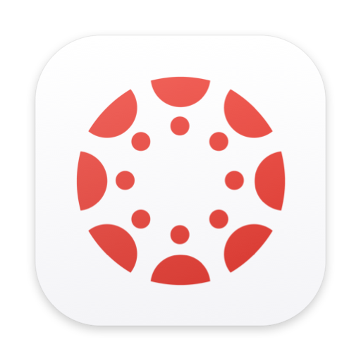

# CanvasBar

macOS 菜单栏上的 Canvas（LMS）课程助手：自动把课程材料同步到本地、追踪 DDL、一键直达课程页面 —— 不用再每天开浏览器翻 Canvas。

<p align="center"></p>

纯 Swift 单文件实现，零第三方依赖，无 Dock 图标（纯菜单栏形态）。默认适配 PolyU Canvas，其他学校 / 自建 Canvas 实例可在菜单里修改域名。

## 功能

- **课程一键直达**：点课程名 → 「在 Canvas 打开课程」/「打开课程文件夹」，文件点击直接用默认应用打开
- **自动同步**：启动时 + 每 30 分钟增量同步「模块文件 ∪ 公告附件 ∪ 页面正文引用」三源并集到 `~/Documents/Canvas 同步/<课程>/`
- **智能去重**：同步的文件在文件夹内随意整理（按周 / 按类型 / 建子文件夹）都不会重复下载，重命名除外
- **按你的文件夹结构展示**：课程子菜单实时跟随磁盘目录树（子文件夹 = 下级菜单），不是死板的平铺列表
- **DDL 追踪**：菜单栏显示最近截止剩余天数（如 `7d`），展开看最近 3 条；已交自动隐藏，支持手动添加 Deadline、标记已提交
- **外部链接收录**：课程里的 Google Drive / Zoom 回放 / 表单等外部链接自动进子菜单，一键浏览器打开
- **课程级控制**：单课立即同步 / 按课程开关（关闭课程不会删除已同步文件）
- **稳健登录**：内嵌登录窗完成 SSO（含 ADFS/SAML 跳转），Cookie 持久化，会话过期自动检测处理，全程不跳外部浏览器
- **可选的省空间模式**：跳过视频 / 大文件，为跳过的内容生成 `.webloc` 在线链接

## 安装（普通用户）

1. 从 [Releases](../../releases) 下载 `CanvasBar-x.x.x-universal.zip`（Apple 芯片 + Intel 通用，需 macOS 13+）
2. 解压后把 `CanvasBar.app` 拖入「应用程序」文件夹
3. 首次打开：右键点 App → 选择「打开」；若仍被系统拦截，到 系统设置 → 隐私与安全性 → 点「仍要打开」
   （本应用为本地签名，未做 Apple 公证，属于正常现象）
4. 启动后菜单栏出现图标 → 点「登录 Canvas…」完成学校统一认证
5. 首次同步会请求「文档」文件夹访问权限，允许即可

## 构建（开发者）

环境要求：macOS 13+，Xcode Command Line Tools（`xcode-select --install`）。

```bash
./build.sh    # 编译 → .build/CanvasBar.app（本机架构）→ ad-hoc 签名
./package.sh  # 发布打包 → dist/CanvasBar-<版本>-universal.zip（arm64 + x86_64）
```

没有 Xcode 工程文件，`swiftc` 直接编译单文件，改完即建。

## 数据位置

- 配置与状态：`~/Library/Application Support/CanvasBar/`（config.json / state.json / manifest.json 等）
- 同步目录：`~/Documents/Canvas 同步/` —— 应用的唯一写入边界，只增不删，不碰其他目录

## 说明

- 去重只认文件名：库内可以随意组织子文件夹，但不要重命名文件
- SSO 需要在应用内嵌浏览器中完成；个别学校的安全策略可能不允许内嵌登录
- 本工具只读取 Canvas 上你有权限访问的课程内容，等价于你自己在浏览器里能看到的范围

## English

A lightweight macOS menu bar app for Canvas LMS. It auto-syncs course materials (modules, announcement attachments and page references) into `~/Documents/Canvas 同步/<course>/`, tracks assignment deadlines right in the menu bar, and gives you one-click access to every course, file and external link — without opening a browser. Pure Swift, zero dependencies, no Dock icon. Built and tested against PolyU Canvas; the Canvas base URL is configurable for other instances. Requires macOS 13+ (universal binary).

## License

[MIT](LICENSE)
